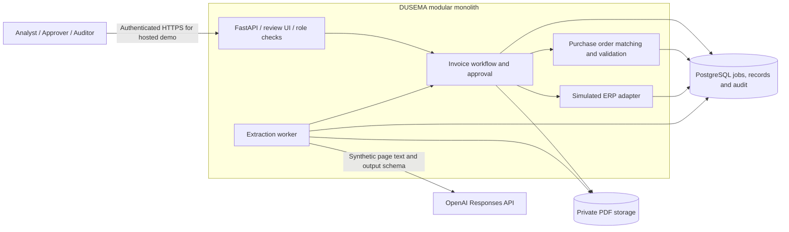

# DUSEMA AI Discovery and MVP Plan

**Phase 0 closed · Scope and architecture approved on 2026-11-26**

DUSEMA AI is a proposed enterprise automation platform for document-driven workflows that require evidence, business validation, and human authorization. Its first release targets accounts payable. It turns a synthetic invoice PDF into a reviewable comparison with a purchase order and records the invoice in a simulated ERP after approval.

The project has two equally important goals. It delivers professional business automation and develops demonstrable skills for a transition into AI Engineering, Generative AI Engineering, and Agentic AI Engineering, with an initial focus on opportunities in Medellín, Colombia. Each phase should balance business usefulness, implementation complexity, and skills the developer can demonstrate and explain.

## 1. Critical assessment

The first release is intelligent document processing with a deterministic workflow and human approval. Runtime tool selection and agentic behavior are explicit goals of the Finance Agent release. The [release roadmap](ROADMAP.md) keeps LangGraph, LangChain, MCP, RAG, pgvector, Redis, Next.js, multi-agent coordination, microservices, and Azure under consideration for the problems that justify them.

The main engineering challenge is deciding whether an invoice is safe to post when extraction is incomplete, two orders appear plausible, an order changes during review, or two requests arrive concurrently. These cases demonstrate more than a polished success path. LangGraph and tool calling have a place when branching, resumption across independent tools, or runtime tool selection becomes essential. The invoice workflow has a known sequence and a single external decision by a human. A versioned state machine is enough to represent that sequence.

The product premise remains a hypothesis. Reviewers should be able to do less transcription and resolve discrepancies faster when values, source evidence, and expected amounts appear together. Measure this during trials with representative reviewers before making claims about savings or accuracy. Synthetic data can establish repeatability and failure behavior. A future pilot requires separate evidence of generalization to real invoices.

## 2. Product, business problem, and value

| Area | Definition |
| --- | --- |
| Initial customer profile | Small or mid-sized company with a purchasing system, structured purchase orders, and an accounts payable team reviewing invoices received as PDFs |
| Business problem | Staff transcribe invoice data, search for the corresponding order, reconcile lines and taxes, check for duplicates, and reconstruct decisions across disconnected systems |
| Value proposition | One review screen with a proposed match, field-level evidence, explicit discrepancies, and a traceable approval and posting outcome |
| Product boundary | DUSEMA owns ingestion, recommendation, validation, approval records, and integration requests. The ERP remains the system of record for posted invoices |
| Success hypotheses | Lower active review time and correction effort, consistent detection of discrepancies, and complete traceability from a posted invoice to its review |

| User | Use case |
| --- | --- |
| Accounts payable analyst | Submit a PDF, inspect extraction evidence, correct fields, select an eligible order reference for revalidation, and monitor the result |
| Approver | Review the evidence and decision version, approve eligible invoices uploaded by another user, or reject with a reason |
| Auditor | Read historical runs, revisions, decisions, and linked posting events across the organization |
| Demo operator | Load synthetic catalog and order fixtures, inspect operational failures, and demonstrate restricted roles |

## 3. MVP scope and exclusions

The MVP covers text-based synthetic PDFs in Spanish, a single demo organization with separate user identities, COP, one invoice per full open order, and a simulated ERP stored in the same PostgreSQL database. Proposed input limits are 5 MiB, 10 pages, and 30 invoice lines. The review surface includes upload, execution status, source references, differences, approvals, and history. Integration boundaries are typed so a different model or storage adapter can be added later.

The MVP excludes scanned and encrypted PDFs, OCR, real invoices or customer data, DIAN and e-invoicing integrations, tax compliance certification, inventory receipts and three-way matching, partial orders and deliveries, multiple orders or invoices per order, credits, discounts, withholding, foreign currency, payments, exception overrides, production ERP connectors, SaaS signup and billing, and organization administration. Advanced dashboards, real-time collaboration, the other six agents, RAG, embeddings, MCP, dynamic tool calling, and supervisor orchestration belong in later phases. A local, reproducible portfolio demo is the MVP deliverable. Cloud hosting is a separately costed portfolio milestone.

### Approved business rules

- Identify the supplier using an exact normalized tax identifier against the seeded catalog. Treat identifier syntax and invoice numbering as fixture conventions. Preserve leading zeros and meaningful punctuation in invoice numbers.
- Accept an explicit order reference only when it belongs to the identified supplier and organization and the order is eligible. For an absent reference, show a bounded shortlist of open orders for that supplier, ordered by deterministic SKU overlap and amount difference. Require a human selection even for a single suggestion. Invalid or conflicting references require a recorded correction or rejection.
- Match by SKU and unit. Support one line per SKU and unit in both documents. Flag missing, extra, or repeated lines. Compare quantities, unit prices, declared tax rates, calculated line tax, and invoice subtotal, tax, and total. Use decimal arithmetic and two decimal places for monetary amounts under `ROUND_HALF_UP`. Round the line net amount, compute and round line tax, sum the rounded lines and taxes, and compare declared amounts exactly at the fixture precision. These rules are for synthetic data and make no claim of Colombian tax compliance or certification.
- Record findings with codes, severity, actual and expected values, and supporting references. Missing evidence, ambiguous matches, mismatches, duplicate business keys, stale approvals, and ineligible orders block posting. An analyst can correct extraction or order selection with a reason. Every correction creates a new revision and triggers validation. Commercial mismatches are rejected if the underlying values are correct. A clean comparison still requires approval from a different user.

## 4. Requirements

### Functional requirements

| ID | Requirement | Observable acceptance |
| --- | --- | --- |
| FR-01 | Authenticate users and scope access by organization and role. | Analysts upload and edit review data. Approvers decide on eligible invoices uploaded by someone else. Auditors can only read. Protected objects cannot be accessed from another organization. |
| FR-02 | Accept and retain eligible PDF uploads with a content hash. | A supported PDF returns a durable run ID. An exact replay returns the existing authorized run. Unsupported, oversized, and unreadable inputs get a classified outcome. |
| FR-03 | Extract invoice header, supplier tax ID, order reference, currency, line items, and declared totals with evidence. | Typed output contains values or explicit empty fields. The application verifies page and text citations and identifies missing or conflicting evidence. |
| FR-04 | Identify the supplier and resolve or propose a purchase order. | A valid reference resolves within the same supplier and organization. Ambiguity, conflicting references, and absent candidates produce an actionable status. |
| FR-05 | Validate invoice lines, taxes, totals, and duplicate indicators. | Seeded examples produce the expected finding codes and amounts and cannot advance while a blocking finding exists. |
| FR-06 | Present the report and accept human decisions. | A reviewer can inspect expected and observed values, resolve extraction issues with a reason, approve a valid report, or reject with a reason. Stale versions cannot be approved. |
| FR-07 | Post the approved invoice to the simulated ERP. | Successful approval produces one ledger record. Concurrent or retried requests cannot create an additional posting for the same business key or purchase order. |
| FR-08 | Expose status, history, and classified failures. | Users authorized for a run can trace the upload, extraction attempt, selected order, report revision, decision, and final outcome. The recovery path is visible for retryable errors. |

### Nonfunctional requirements

| ID | Requirement | Proposed release check |
| --- | --- | --- |
| NFR-01 | Enforce access and isolate data. | Test unauthorized upload, view, download, correction, approval, and posting. Exercise two synthetic organization scopes in tests. Serve files with authorization and escape document text in UI views. |
| NFR-02 | Make writes durable and idempotent. | Restart after an interrupted extraction and recover the job. Race duplicate submissions and approvals against real PostgreSQL. Validate rollback on a posting failure. |
| NFR-03 | Bound operational work. | One worker for the demo, a processing deadline, at most one automatic retry for transient provider errors, and an application-side cap on attempts and estimated spend. Record p50 and p95 excluding human wait. Start with a proposed p95 target of 30 seconds under the defined single-worker demo workload. |
| NFR-04 | Protect data and secrets. | Use synthetic inputs, private file access, secrets outside version control, and logs with identifiers and usage metadata only. Verify that files, raw prompts, keys, and complete invoice values are absent from application logs. |
| NFR-05 | Make behavior reproducible and observable. | A clean checkout can migrate, seed, and run the offline flow using documented steps. Correlate events and timings by run and link them to document, prompt, model, and rules versions. |
| NFR-06 | Support an accessible workflow. | Complete upload, findings review, approval and audit navigation using a keyboard, with labeled controls, visible focus, and statuses communicated in text. |
| NFR-07 | Protect authenticated sessions and state changes. | Verify session rotation, expiration and revocation, server-side role and organization checks, trusted origin checks, and per-session CSRF protection. Apply the [initial security policy](SECURITY.md). |

## 5. Initial architecture

Use one Python codebase and deployable image. Its HTTP process serves the API and the server-rendered review interface. A worker from the same codebase polls persisted extraction jobs. Both use a single PostgreSQL database. The worker exists so a request can return a durable run identifier before inference and so extraction can recover after a restart. PostgreSQL is sufficient for this job volume and preserves a single infrastructure dependency for workflow state.



The business modules are identity, documents, purchasing, invoices, approval, and audit. Invoices orchestrates the workflow. Adapters cover file storage, model extraction, and ERP posting. Storage and external API calls sit outside database transactions. A database transaction owns each consistent state change and its audit event. The document becomes visible as received only after the object is stored and the database commits. A failed database write triggers cleanup of the staged object, with a reconciliation path for interrupted cleanup.

The worker atomically claims a job with an expiring lease and an attempt identifier. It verifies ownership before writing a result, so an expired attempt cannot overwrite a newer one. A restart can repeat a provider call after an ambiguous timeout. Record attempts and measure the cost of these retries. The simulated ERP uses the invoice approval transaction for its final posting, so approval, ledger entry, completion state, and audit commit together. A real ERP would require a separate delivery and reconciliation design.

The model receives text identified by page and a narrow extraction schema. Operations such as selecting a supplier, calculating taxes, granting approval, and writing to the ERP use typed application services under explicit roles. The model has no executable tools, external links, direct database access, or write credentials. Document instructions are treated as data. Text shown in the review UI is escaped. Approval, download, and audit routes enforce organization scope from the authenticated identity.

## 6. Approved technology baseline

| Decision | Rationale and trade-off |
| --- | --- |
| Python 3.14, FastAPI, Pydantic v2 | A runtime in bug-fix support, typed request validation, dependency injection for auth and adapters, and a documented API. The model schema and financial domain rules remain explicit contracts. Foundation uses uv and a versioned lockfile for reproducible resolution. [Python support](https://devguide.python.org/versions/), [FastAPI release notes](https://fastapi.tiangolo.com/release-notes/), [uv locking and syncing](https://docs.astral.sh/uv/concepts/projects/sync/) |
| PostgreSQL 18, stable SQLAlchemy 2.x, Alembic | PostgreSQL provides transactional locking and unique constraints. SQLAlchemy gives explicit transaction boundaries and Alembic gives reviewable migrations. SQLite would simplify setup but weaken parity for concurrent posting tests. Verify the selected PostgreSQL major in the target Azure region before hosting. [PostgreSQL constraints](https://www.postgresql.org/docs/18/ddl-constraints.html), [SQLAlchemy transactions](https://docs.sqlalchemy.org/en/21/orm/session_transaction.html), [Alembic](https://alembic.sqlalchemy.org/en/latest/tutorial.html), [Azure version support](https://learn.microsoft.com/en-us/azure/postgresql/configure-maintain/concepts-supported-versions) |
| pypdf for text, template parser as baseline, OpenAI Structured Outputs as candidate | Page extraction preserves a reference for each value. A template parser is cheap and useful for known layouts. A model can handle layout variation and ambiguous headings, with extra cost and failure modes. Structured Outputs constrains the response shape. Field truth, refusal handling, and domain checks still belong to the application. Use one provider interface and a local fixture adapter for deterministic CI. [pypdf text extraction](https://pypdf.readthedocs.io/en/stable/user/extract-text.html), [OpenAI Structured Outputs](https://developers.openai.com/api/docs/guides/structured-outputs) |
| FastAPI and Jinja2 review interface | A server-rendered interface supports a single origin, one deployable app, and short feedback cycles on the review experience. Next.js, React, TypeScript, and Tailwind remain options when UI interaction, component reuse, or separate frontend ownership justifies a second build. [FastAPI templates](https://fastapi.tiangolo.com/advanced/templates/), [Next.js installation](https://nextjs.org/docs/app/getting-started/installation) |
| Docker Compose, GitHub Actions, pytest, private storage | Use Compose for local parity, GitHub Actions for CI, and pytest with real PostgreSQL for transactional cases. A mounted volume implements the local file adapter. Azure Blob Storage is the proposed hosted adapter if hosting is approved. |
| Structured events in the MVP | Correlate logs and usage metrics by run ID. Consider OpenTelemetry for distributed tracing or Langfuse when comparing many prompts and models warrants a dedicated evaluation interface. Audit events remain in the application database. |
| Defer orchestration and additional infrastructure | Prefer application state plus PostgreSQL for the first fixed workflow. Reconsider LangGraph when multiple resumable branches need orchestration, Redis or a queue when measured throughput requires it, and pgvector when a knowledge retrieval use case exists. Evaluate LangChain or MCP when multiple connectors justify their abstractions or interoperability. [LangGraph capabilities](https://docs.langchain.com/oss/python/langgraph/overview) |

### Compatibility evidence on 2026-11-26

| Scope | Verified versions and behavior |
| --- | --- |
| First application increment | Python 3.14.10 and uv 0.13.10 resolved and installed the locked environment. FastAPI 0.165.0, Pydantic 2.14.4, pydantic-settings 2.16.3, Uvicorn 0.54.0, pytest 9.2.0, and Ruff 0.17.6 passed the local application, lint and formatting checks. |
| Persistence and server-rendered UI candidates | Docker Compose 5.7.0 started a temporary PostgreSQL 18.7 container. SQLAlchemy 2.1.9 and Psycopg 3.3.9 connected from Python 3.14.10. Alembic 1.20.1 created and dropped a probe table in a database transaction. Jinja2 3.1.6 rendered escaped HTML in an isolated check. The temporary services were stopped and removed. Product migrations, runtime database configuration and templates are later increment work. [PostgreSQL maintained versions](https://www.postgresql.org/support/versioning/), [SQLAlchemy PostgreSQL dialect](https://docs.sqlalchemy.org/en/21/dialects/postgresql.html), [Alembic tutorial](https://alembic.sqlalchemy.org/en/latest/tutorial.html) |

## 7. Preliminary data model

| Entity | Key fields and relationships |
| --- | --- |
| `Organization`, `User`, `Membership` | Identity, organization membership, role. Demo data seeds a single organization and separate analyst, approver, and auditor accounts |
| `Supplier` | Organization, supplier name, normalized tax ID. Unique scoped tax ID |
| `PurchaseOrder`, `PurchaseOrderLine` | Organization, supplier, order reference, lifecycle status, currency, revision. Lines include SKU, unit, expected quantity, unit price, and tax rate |
| `Document` | Organization, uploader, storage key, content hash, size, page count, timestamp. Unique organization and SHA-256 pair |
| `InvoiceRun`, `ExtractionAttempt` | Document, status, current revision, job lease, attempt number, timestamps, parser/model identifier and version, prompt/schema versions, token use, classified failure |
| `InvoiceRevision`, `InvoiceLine` | Run, revision number, normalized fields, evidence locators, reviewer changes, reason, actor, timestamp. Lines hold SKU, unit, quantity, unit price, and tax |
| `ValidationReport`, `ValidationFinding` | Invoice revision, order and order revision, rules version, readiness, finding code, severity, expected and actual value, evidence locator |
| `ApprovalDecision` | Report, actor, decision, reason, timestamp, and request identifier. One final decision per report, with stale reports rendered ineligible for posting |
| `SimulatedERPPosting` | Invoice revision, approval, supplier, normalized invoice number, order, simulated ERP reference, timestamp |
| `AuditEvent` | Organization, actor or system identity, action, resource and run IDs, timestamp, correlation ID, minimal metadata |

Use decimal types end to end for money and quantities, UTC timestamps, and organization-scoped keys and foreign keys on business relationships. Store original PDFs in private storage. Persist verified evidence as a page reference and a minimal source excerpt, with reviewer corrections recorded separately. Restrict audit mutation in the application and through database permissions. A separate immutable external audit store is a later option if required.

At posting, materialize a non-null unique key on `(organization, supplier, normalized invoice number)` and a unique key on `(organization, purchase order)` for the full-order MVP policy. The document hash detects identical files, the business key detects different files referencing the same invoice, and the order key prevents two invoices consuming the same full order. An idempotency key scoped to the actor and decision endpoint maps repeat requests to the previous outcome and rejects reuse with a different payload.

## 8. Invoice workflow and recovery

| Step | Behavior and outcome |
| --- | --- |
| 1. Receive | Check access, size, PDF signature and parseability. Stage the private file, hash the content, and persist the run and job. An exact repeat returns its existing run identifier to an authorized user. |
| 2. Extract | Parse page text under resource bounds. Reject unsupported documents with a specific reason. Send bounded page text to the selected extractor. Record schema and prompt versions and provider usage. |
| 3. Verify extraction | Validate schema and parse amounts and dates explicitly. Check that page citations exist and the excerpt supports the extracted value. Send absent, unparseable, or unsupported critical fields to review. Treat refusal, timeout, and incomplete inference as separate outcomes. |
| 4. Match and validate | Look up the supplier and order within the same organization. Apply the rules in section 3 and produce findings. Check the business key against existing postings and surface an in-flight duplicate candidate when available. |
| 5. Review | An analyst can correct values or select an order with a reason. Recompute the report and keep the preceding version in history. An eligible report enters `AWAITING_APPROVAL`. An unresolved report stays in `NEEDS_REVIEW` and can be rejected by an approver. |
| 6. Decide and post | Verify the role and uploader separation. In one transaction, lock the relevant run and order, verify the report and current order revision, recheck eligibility and duplicates, and write approval, posting, status and audit. Reject with a reason or ask for revalidation when the order changed or a conflict arose. |
| 7. Recover and inspect | Expose run history of claims, retries, classification, findings, corrections, decisions, and posting. A temporary provider error allows one controlled retry. An unsupported file or invalid extraction requires a new document or analyst review, as applicable. |

Proposed run statuses are `RECEIVED`, `PROCESSING`, `NEEDS_REVIEW`, `AWAITING_APPROVAL`, `POSTED`, `REJECTED`, `UNSUPPORTED`, and `FAILED`. An approval on the current eligible report transitions directly to `POSTED` for the simulated ERP. Retryable failures are identified by a stored error category. Failed or unauthorized requests cannot advance the workflow. A failed posting transaction preserves the previous eligible state while an operational record captures the failure separately.

### Initial acceptance scenarios

| Synthetic case | Expected outcome |
| --- | --- |
| AC-01 · One open order and a valid PDF each contain 2 units at COP 100.00, with synthetic tax of 19%. | The report shows COP 200.00 subtotal, COP 38.00 tax and COP 238.00 total, with page evidence. The ledger stays empty before approval. The uploader cannot approve. A distinct approver receives one posting reference, and replay of the same decision returns it without a second posting. Audit links the upload, report, decision, and posting. |
| AC-02 · A PDF declares 3 units and COP 357.00 total, while the open order allows 2 units and COP 238.00. | The report shows expected and observed quantities, evidence and a blocking finding. An authorized approver cannot post the discrepancy. An attempted revision to 2 lacks support from the PDF and remains ineligible. Rejection records the reason and the ledger stays empty. |
| AC-03 · Two differently formatted PDFs declare the same normalized supplier invoice number for distinct eligible orders in one organization. | First verify that the document hashes differ. Attempt posting both reports concurrently and verify at most one ledger row, one `POSTED` run, and a duplicate result visible in the other run. Reupload of the exact bytes follows the file-replay policy. A separate concurrency test covers two invoice numbers targeting the same full order. |

These are acceptance specifications for the invoice workflow. Foundation verifies only its own application and environment checks.

## 9. Repository and documentation proposal

```text
dusema-ai/
├── README.md, AGENTS.md, CONTRIBUTING.md, CHANGELOG.md
├── docs/
│   ├── DISCOVERY.md
│   ├── PRODUCT_VISION.md, REQUIREMENTS.md, ARCHITECTURE.md
│   ├── AI_ARCHITECTURE.md, DATA_MODEL.md, SECURITY.md
│   ├── ROADMAP.md, BACKLOG.md, EVALUATION.md, DEPLOYMENT.md
│   └── adr/
├── src/dusema/
│   ├── api/, web/, worker/
│   ├── identity/, documents/, purchasing/, invoices/, approvals/, audit/
│   └── adapters/, config/
├── migrations/
├── tests/unit/, tests/integration/, tests/e2e/
├── evals/datasets/, evals/results/
├── .github/workflows/
└── pyproject.toml, dependency lockfile, Dockerfile, compose.yaml, .env.example
```

Keep the approved baseline here and move detailed requirements into dedicated documents as they become active. The first ADRs cover the [monolith and durable worker](adr/0001-modular-monolith-and-postgresql-worker.md), [extraction and validation](adr/0002-document-extraction-and-deterministic-validation.md), and [approval and posting](adr/0003-atomic-approval-and-simulated-posting.md). `AGENTS.md` carries collaboration rules. `README.md` explains local setup, and `DEPLOYMENT.md` will describe the release procedure when hosting is selected. Public documentation and code use English. Mentoring and design discussions use Spanish.

## 10. Roadmap and professional competencies

The delivery order for V0.1 is 0 → 1 → 2 → 3 → 6A → 7A, followed by work on the local portfolio demo. The [version roadmap](ROADMAP.md) sequences Finance Agent, Knowledge Agent, enterprise orchestration, and the integrated platform after V0.1. Test and instrument each slice as it is built.

| Phase | Deliverable and evidence | Professional competencies |
| --- | --- | --- |
| 0 · Discovery | Approved scope, sample cases, high-level design, acceptance criteria, and prioritized backlog | Domain discovery, requirements, technical trade-offs, ADRs, risk estimation |
| 1 · Foundation | Clean checkout starts, migrates, seeds, and runs CI checks | Packaging, Git, Docker, relational modeling, migrations, CI, configuration hygiene |
| 2 · AI Core | Fixture and live extraction adapters implement one schema, with provenance and failure telemetry | Structured model interfaces, prompt versioning, defensive parsing, token budgeting, contract testing |
| 3 · Invoice processing | API demonstrates valid posting, exceptions, distinct approval identity, audit, and concurrency recovery | Workflow state, transactional guarantees, decimal arithmetic, access control, idempotency |
| 4 · Enterprise knowledge | One documented retrieval use case with evidence and benchmark | Ingestion, chunking, embeddings, hybrid retrieval, relevance evaluation |
| 5 · Integrations | One connector with scoped permissions, guarded tool execution, and recoverable writes | API integration, tool calling, MCP trade-offs, authorization, integration contracts |
| 6A · MVP review UI | Accessible upload, detail, approval, and history views | Workflow UX, form design, accessibility, end-to-end testing |
| 6B · Enterprise UX | Role-specific workspaces and higher-complexity views as usage requires | Component systems, TypeScript and frontend architecture, product analytics |
| 7A · MVP evaluation | Reproducible comparison of baseline and model with labeled data, failure slices, cost, and latency | Dataset design, evaluation harnesses, error analysis, LLMOps, performance measurement |
| 7B · Expanded observability | Monitoring and regression thresholds across multiple workflows | Telemetry design, trace analysis, reliability and optimization |
| 8 · Portfolio release | Demo script, architecture and evaluation evidence, interview walkthrough, optional Azure deployment and teardown | Release engineering, cloud operations, documentation, communicating engineering decisions |

## 11. Prioritized backlog

P0 is required for the MVP, P1 improves the portfolio release or requires a separate decision, and P2 belongs to product expansion. Implement P0 in small slices and demonstrate each acceptance criterion on fixtures.

| ID | Priority and phase | Work item | Acceptance criteria |
| --- | --- | --- | --- |
| B01 | P0 · 0 | Approve scope and business policies | **Closed.** Scope, approval roles, document types, posting rules, and the proposed evaluation budget are recorded. Remaining decisions have a phase or milestone. |
| B02 | P0 · 1 | Bootstrap local environment and CI | A fresh setup starts the app and database, applies migrations, and seeds test accounts and purchase orders. CI runs without a paid key. |
| B03 | P0 · 1 | Enforce identity and organization scope | Distinct demo users with consistent permissions can log in. Denied cross-role and cross-organization actions pass integration tests. |
| B04 | P0 · 2 | Ingest a PDF and claim an extraction job | A valid upload returns a run ID. Exact replay, unsupported media, worker restart and expired lease produce expected outcomes. |
| B05 | P0 · 2 | Define extraction and evidence contracts | Baseline, fixture and model adapters return the same schema. Missing evidence, refusal, and incomplete inference follow the specified failure or review path. |
| B06 | P0 · 3 | Match supplier and order and validate amounts | Fixtures cover exact and ambiguous references, missing or extra lines, quantities, prices, taxes and totals. Report links each finding to the observed field and expected data. |
| B07 | P0 · 3 | Correct and revalidate an invoice | Corrections with reasons create immutable earlier revisions and a new report. Approval of an older revision is rejected. |
| B08 | P0 · 3 | Approve, post once, and audit | A separate approver posts exactly one ledger entry. Concurrent duplicate approvals, concurrent invoices for one order, stale orders and transaction failures preserve consistency. |
| B09 | P0 · 6A | Deliver the review and history screens | A keyboard-only user can upload, inspect evidence and discrepancies, and act within role permissions. Each posted invoice exposes its decision history. |
| B10 | P0 · 7A | Package evaluation dataset and run the benchmark | Versioned fixtures and expected outcomes are reproducible. Reports include denominators, baseline and model results, versions, cost, latency, and failure categories. |
| B11 | P1 · 8 | Prepare portfolio demonstration and assess Azure | Local demonstration runs from documented steps. If hosting is approved, document and verify a minimal deploy, budget, restoration path, and teardown. |
| B12 | P2 · 4/5 | Assess a second workflow or integration | An agreed use case and acceptance measure justify the extra dependency or abstraction. |

## 12. Tests and AI evaluation

Run unit tests for normalization, decimal calculations and rounding, findings, eligibility, and state transitions. Run integration tests against PostgreSQL for migrations, idempotency, isolation, concurrent posting and lease recovery. Include end-to-end valid, corrected, rejected, duplicate, and recovery paths from upload through audit. Security tests exercise role boundaries, access to another organization's files, unsafe document content treated as data, storage access and redacted logs. Run offline in CI using a scripted model adapter. Execute live model evaluations separately with synthetic data and an approved spending cap.

The approved corpus contains 60 synthetic invoices, including 36 development examples and 24 held-out examples. Group the split by document template or supplier family to avoid placing layout variants on both sides. Cover clean matches, ambiguity, duplicates with different PDF bytes, missing values, unsupported files, decimal formats, tax and total mismatches, and instructions embedded in documents. Use a versioned manifest with expected values, evidence locations, match outcome, findings and eligibility. Keep enough eligible and ineligible cases in the holdout to report both denominators. A small synthetic benchmark is evidence for these cases and designs.

Compare three paths on identical fixtures. The template/regex baseline measures what deterministic extraction can do. The LLM extractor measures improvements on varied layouts and the cost of abstentions and errors. Oracle values from the manifest isolate downstream validation from extraction failures. Keep matching inputs, financial rules and decision gates fixed. Compare a second model only after the first baseline and model run are reproducible. Track manual review time and number of corrections in a small separate walkthrough if representative reviewers are available.

| Measure | Definition and proposed release use |
| --- | --- |
| Critical field exact match | Correct normalized values divided by annotated critical field instances. Count missing or invalid values as incorrect. Report supplier ID, invoice number, PO reference when present, currency, items and totals separately. Proposed target of at least 95% aggregate, subject to corpus review. |
| Line-item accuracy and evidence | Match annotated rows by SKU and unit and report precision, recall, and field accuracy. Measure supported critical values among returned critical values. A field without supporting evidence is ineligible for posting. |
| Validation precision and recall | Compute a confusion matrix on findings and final eligible status. Report false flags per eligible invoice and missed blocking findings per invalid invoice. Measure oracle and extracted inputs separately. |
| Safety and completion | Require zero incorrect postings in the held-out and concurrency suites, and all deterministic rule and permission tests passing. Report task completion as eligible posts divided by expected eligible cases, plus reviews, failures and rejections separately. Zero observed incorrect postings describes the test suite only. |
| Operational quality | Report latency p50/p95 from receipt to review result, queue wait, extraction latency, provider failure and retry rates, input and output tokens per attempt, and billed-model cost per run. Separate timed workload from manual review. |

Capture dataset version, template split, provider/model or snapshot identifier where available, prompt and schema versions, rules version, retry configuration, application commit and date for each run. Report sample counts and per-layout results before drawing conclusions. Tool-selection precision, RAG recall, answer faithfulness, and agent comparisons become relevant when their features exist.

## 13. Risks and mitigations

| Risk | Impact | Mitigation and validation |
| --- | --- | --- |
| Layout and table variation | Wrong or omitted values | Evidence per field, conservative review, baseline comparison, and held-out template families |
| Wrong supplier or order match | Invalid ERP record | Exact supplier matching, authorized human selection for suggestions, revision checks, and blocking ambiguity |
| Duplicate or stale approval under concurrency | Repeated or inconsistent posting | Transactional state changes, row locks, unique constraints, explicit idempotency and real database races |
| Prompt injection or malicious file content | Corrupted extraction or unauthorized exposure | Bounded binary parsing, isolated worker permissions, escaped text, no model tools, scoped access, and fixtures with unrelated document instructions |
| Sensitivity and provider retention | Exposure in prompts, stored responses or logs | Synthetic-only MVP, send page text needed for extraction, verify provider data controls and retention before using real data, and test log redaction. [OpenAI data controls](https://developers.openai.com/api/docs/guides/your-data) |
| Model drift, outage, or rising cost | Unstable outcomes or budget overruns | Record versions, retain a deterministic adapter, cap retries and spend, and rerun a fixed evaluation before switching models |
| Synthetic benchmark optimism | Overstated business value | Publish limitations and denominators, test distinct layouts, and gather reviewer workflow evidence before proposing a production pilot |
| Scope creep | Long delay before a demonstrable workflow | Build the invoice slice first. Reassess new modules when beneficiary, success measure, and infrastructure need are clear |

## 14. Development and operating costs

Estimated solo development effort is 82–126 hours for phases 1, 2, 3, 6A, and 7A. The breakdown is 12–18 hours for Foundation, 16–24 for AI Core, 32–48 for invoice workflow, 10–16 for the review UI, and 12–20 for evaluation. Phase 8 adds about 8–14 hours if the cloud and portfolio release are included. At 10 hours per week the local MVP is roughly 9–13 weeks. At an illustrative opportunity cost of USD 20/hour the local MVP represents USD 1,640–2,520 in time, with infrastructure budgeted separately.

| Operating scenario | Estimated cost and assumptions |
| --- | --- |
| Local offline development | USD 0 in incremental API and hosting charges using the existing computer and fixture adapter |
| Live model, 100 / 1,000 invoices | Approximately USD 0.90 / 9.00 at GPT-6.1 Terra standard rates, with one attempt per invoice and 4,000 input tokens and 1,000 billed output tokens per attempt. USD 1.08 / 10.80 with an illustrative 20% extra attempts. Prices exclude tax. Actual tokens and account availability must be checked. [Model documentation and standard rates](https://developers.openai.com/api/docs/models/gpt-6.1-terra) |
| Optional Azure portfolio demo | Illustrative East US case with B1ms PostgreSQL at USD 0.017/hour × 730 hours and 32 GB of storage at USD 0.115/GB-month gives about USD 16.09/month for database compute and storage. Budget USD 20–50/month for the hosted demo as a planning allowance before LLM usage. Logs, backups, Blob operations, registry, networking and an ingress-independent worker can change the bill. Container Apps has a subscription-level compute/request grant and the worker runtime still counts toward applicable meters. Confirm region, SKU, policy, stock and spending plan before provisioning. [Azure Retail Prices API](https://learn.microsoft.com/en-us/rest/api/cost-management/retail-prices/azure-retail-prices), [Azure PostgreSQL pricing](https://azure.microsoft.com/en-us/pricing/details/postgresql/flexible-server/), [Container Apps billing](https://learn.microsoft.com/azure/container-apps/billing), [Blob pricing](https://azure.microsoft.com/en-us/pricing/details/storage/blobs/) |

The usage estimate assumes uncached text at USD 1.00 per million input tokens and USD 5.00 per million output tokens, including any billable reasoning in the output budget. The proposed monthly model-call budget is **USD 10**. The budget is a planning ceiling. Paid calls and cloud provisioning each require explicit project-owner authorization. Design evaluation and continuous integration to work without paid keys. Track evaluation and operating usage separately and reserve application-side budget before a paid request once approved. Infrastructure prices and model rates were checked on 2026-11-26. [GPT-6.1 Terra pricing](https://developers.openai.com/api/docs/models/gpt-6.1-terra)

## 15. Decisions carried forward

| Decision | Due | Initial direction |
| --- | --- | --- |
| Persistence baseline and exact deployment pins | Foundation persistence increment | Verify PostgreSQL major and minor, Psycopg, SQLAlchemy, and Alembic with a clean Compose startup and migration cycle before locking deployment versions. |
| Pre-authentication and session timeouts | Before B03 implementation | Use seeded local accounts and server-managed sessions. Review the defaults and test the security criteria in [SECURITY.md](SECURITY.md). |
| Input limits and evidence locator details | Before B04–B05 | Start with the proposed PDF caps and page plus excerpt references. Calibrate against sample fixtures and enforce resource bounds. |
| Live model, provider allocation, and release performance thresholds | AI Core and evaluation | Start with offline fixtures, record real measurements, confirm account availability, and obtain separate authorization for paid evaluation. |
| Hosting identity, region, sizing, and budget | Optional cloud release | Choose only when a hosted demo is approved. The local V0.1 demo remains the release target. |

## 16. Definition of Done

- The increment works through its intended entry points and satisfies its documented acceptance criteria with reproducible steps.
- Tests cover behavior changed by the increment, including important failure and recovery paths. Relevant access checks run for every new protected operation. CI runs with public dependencies and synthetic fixtures without paid API keys.
- Validation, error handling, permissions, data isolation, idempotency, and audit behavior are implemented and tested wherever the feature needs them. Evidence from actual checks is available. Pending acceptance criteria remain marked pending.
- Dependencies and environment setup are reproducible. Public technical documentation, decisions, and the runbook reflect the implementation. Known risks or unverified behavior are recorded alongside the change.
- The author can explain the problem, component boundaries, trade-offs, failure behavior, and verification in an interview.
